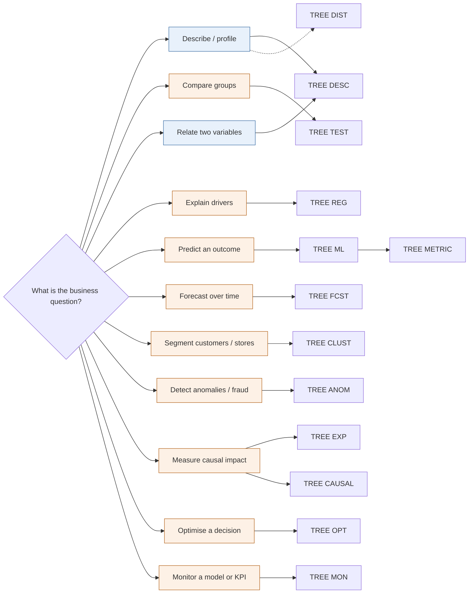

# 02. Statistics Navigator (design + draft decision trees)

The Navigator answers one question for the learner: **"Given my business question and my data, what should I use, what must I check, and what do I do if the check fails?"**

## 1. Master map

Starts from the business question, then branches on data. Each leaf points to a tree below.



Every branch then asks the same five data questions, in this order: **(1) outcome type** (continuous, binary, count, time-to-event, category) → **(2) structure** (independent, paired, clustered, time-ordered) → **(3) sample size and event count** → **(4) distribution shape** (normal-ish, skewed, heavy-tailed, zero-inflated) → **(5) assumptions** (independence, equal variance, linearity, proportional hazards…).

## 2. Node specification (every node in every tree carries this)

| Field | Example (node `N-TEST-2G-MEAN`) |
| --- | --- |
| Use when | Compare average basket value: promo vs non-promo stores |
| Assumptions to check | Independent units; roughly normal means (CLT, n per group > ~30 and not heavy-tailed); unequal variances allowed in Welch |
| If an assumption fails | Heavy tails → Mann-Whitney or bootstrap CI of the difference; clustered units → aggregate to store level or mixed model; paired → paired t |
| Alternatives worth trying | Permutation test; Bayesian estimate of the difference; regression with covariates (CUPED-style) |
| Common pitfalls | Testing transactions when stores were randomised; reading p < 0.05 as "big"; ignoring outliers from bulk buyers |
| Typical business action | Roll out / extend / stop the promo, sized by the CI of the lift, not by the p-value |
| Links | Lesson L3.4 · recipe `rcp_two_group_test` · concepts C129, C131, C141 · glossary |

## 3. Draft decision trees

Notation: `→` leads to a technique; `⟂ fail:` is the fallback when the assumption check fails.

### T1. TREE DESC: which descriptive summary

```
Variable type?
├─ Categorical → counts, %, mode; bar chart; crosstab + Cramér's V for two variables
├─ Numeric
│  ├─ Symmetric, no heavy tail → mean ± SD; histogram
│  ├─ Skewed / heavy-tailed (spend, balances) → median, IQR, percentiles (P90, P99), MAD; log-scale histogram, ECDF
│  ├─ Comparing variability across scales → coefficient of variation
│  └─ Concentration question ("who drives revenue?") → Pareto, Lorenz curve, Gini
├─ Two numeric → scatter; Pearson (linear) ⟂ fail: monotone non-linear → Spearman/Kendall; ties/small n → Kendall
└─ Over time → line chart, rolling mean, seasonal plot (→ T9)
Always first: profile nulls, duplicates, impossible values (→ data quality checklist)
```

### T2. TREE DIST: which distribution to assume

```
Outcome?
├─ Yes/No per unit → Bernoulli; count of yeses in n → Binomial; rate varies by group → Beta-Binomial
├─ Count of events in a period
│  ├─ variance ≈ mean → Poisson
│  ├─ variance > mean (over-dispersed) → Negative Binomial
│  └─ many zeros → zero-inflated / hurdle; intermittent demand (→ T9)
├─ Sampling without replacement from a finite lot → Hypergeometric
├─ Positive, right-skewed amount (spend, income, claim severity) → Lognormal or Gamma (compare AIC, Q-Q)
├─ Time until event → Exponential (constant hazard) ⟂ fail: hazard changes → Weibull
├─ Proportion / probability itself → Beta
├─ Extreme heavy tails (no stable mean) → suspect Cauchy-like / Pareto: use medians, quantiles, robust methods
└─ Sharp peak, fat tails around 0 (price changes) → Laplace
Check: Q-Q plot + AIC across candidates; KS/AD tests only as a guide (large n always rejects)
```

### T3. TREE TEST: which hypothesis test

```
Outcome type?
├─ Continuous
│  ├─ 2 groups
│  │  ├─ independent → Welch t ⟂ fail: heavy tails/small n → Mann-Whitney, permutation, bootstrap CI
│  │  └─ paired (same store before/after) → paired t ⟂ fail: Wilcoxon signed-rank
│  ├─ >2 groups → one-way ANOVA (+ Levene) ⟂ unequal variance: Welch ANOVA + Games-Howell; non-normal: Kruskal-Wallis + Dunn
│  └─ with covariates → regression / ANCOVA (→ T5)
├─ Binary / proportion
│  ├─ 2 groups, large counts → two-proportion z / chi-square ⟂ expected cell < 5: Fisher's exact
│  ├─ paired binary → McNemar
│  └─ >2 groups or categories → chi-square of independence
├─ Counts / rates → Poisson or NB rate test; with exposure → GLM with offset
├─ Time-to-event (censored) → Kaplan-Meier + log-rank ⟂ non-proportional hazards: RMST comparison
└─ Many tests at once → Holm (FWER) or Benjamini-Hochberg (FDR)
Always report: effect size + CI; check power; for experiments run the SRM check first (→ T4)
```

### T4. TREE EXP: sample size and experiment design

```
Can you randomise?
├─ No → observational causal methods (→ T10)
└─ Yes
   ├─ Unit: customer / account / store? Interference or shared shelf/branch → randomise clusters (store, branch)
   ├─ Metric: binary → power for proportions; continuous → power for means (use historic SD); ratio metric → delta method
   ├─ Fix α (0.05 two-sided typical), power (0.8 typical), MDE (the smallest lift worth acting on) → sample size
   ├─ Variance too high → CUPED with pre-period covariate; stratified or paired-store design
   ├─ Need to look early → sequential design (alpha spending) — never ad-hoc peeking
   ├─ Before analysis → SRM chi-square check ⟂ fail: stop, find the assignment bug; do not analyse
   └─ Prior information matters / need probability of being better → Bayesian A/B (Beta-Binomial)
Guardrails: margin, returns, complaints, default rate. Duration ≥ 1–2 full business cycles (novelty effect)
```

### T5. TREE REG: which regression or GLM

```
Outcome?
├─ Continuous, roughly symmetric residuals → OLS
│  ⟂ heteroscedastic: robust SEs or log outcome; ⟂ outliers: robust regression/quantile; ⟂ collinear (VIF > 5–10): drop/combine, Ridge
├─ Positive skewed amount → log-OLS or Gamma GLM (log link)
├─ Binary → logistic regression ⟂ rare events: penalised (Firth) or more data; ⟂ separation: regularise
├─ Count → Poisson GLM (+offset) ⟂ over-dispersion: Negative Binomial; many zeros: zero-inflated/hurdle
├─ Zero mass + positive continuous (claims cost, spend incl. non-buyers) → Tweedie
├─ Interest in tails / percentiles → quantile regression
├─ Many predictors / prediction focus → Ridge, Lasso, Elastic Net
├─ Grouped data (stores, branches) → mixed model with random intercepts
└─ Curvature / effect depends on another variable → polynomial/splines; interaction terms
Diagnostics always: residual plots, VIF, Cook's distance, out-of-sample error
```

### T6. TREE ML: which ML model

```
Goal?
├─ Explainable decision required by regulator → logistic / scorecard (WoE) ⟂ need lift: GBM + SHAP with challenger governance
├─ Tabular prediction, best accuracy → gradient boosting (LightGBM/XGBoost); baseline: logistic/linear; check RF
├─ Small data, many features → regularised linear; SVM
├─ Similarity-based / recommendation → KNN
├─ Text / naive baseline → Naive Bayes
├─ Images, text, sequences at scale → deep learning (awareness)
└─ Rare target (fraud 0.5–1%) → class weights or threshold moving; evaluate with PR-AUC (→ T11)
Always: leakage audit, out-of-time validation, grouped CV if repeated customers, calibration check
```

### T7. TREE CLUST: which clustering method

```
Data?
├─ Numeric, roughly spherical groups, k unknown → K-Means (scale first; elbow + silhouette)
├─ Want a hierarchy / small n → hierarchical (Ward)
├─ Odd shapes, noise points → DBSCAN/HDBSCAN
├─ Overlapping, soft membership → Gaussian mixture (BIC for k)
├─ Mixed categorical + numeric → K-Prototypes / Gower + hierarchical
├─ Many correlated features → PCA first
└─ Business-rule segmentation is enough → RFM
Validate: stability across seeds/samples, profile each cluster, name it, check it drives a different action
```

### T8. TREE ANOM: which anomaly detection method

```
Labels available?
├─ Yes (confirmed fraud) → supervised classifier (→ T6); still run unsupervised for new patterns
└─ No
   ├─ One metric over time → control chart / residual from forecast; change-point (→ T9)
   ├─ One variable, static → robust z (MAD), IQR fences
   ├─ Many variables → Isolation Forest (global) / LOF (local density)
   ├─ Relationships between entities → graph links (shared device/address) → ring detection
   ├─ Amounts bunched below a threshold → structuring check (histogram near threshold)
   └─ Fabricated / rounded numbers → Benford first-digit + last-digit test
Set contamination = alert budget investigators can handle; measure precision on investigated alerts
```

### T9. TREE FCST: which forecasting approach

```
Series type?
├─ Smooth, seasonal, few series → ETS / SARIMA; baseline seasonal-naive
├─ Drivers known (price, promo, holidays, temperature) → ARIMAX / regression with lags / GBM with features
├─ Multiple seasonalities + holidays → Prophet-style
├─ Intermittent (ADI > 1.32) → Croston / SBA; evaluate with MASE not MAPE
├─ Hierarchy (SKU → category → total; store → region) → hierarchical reconciliation (MinT/bottom-up)
├─ Stockouts → treat sales as censored demand before modelling
└─ Structural break → change-point detection, then refit on post-break data
Always: rolling-origin backtest vs baseline, WAPE + bias at the decision level
```

### T10. TREE CAUSAL: which causal method

```
Randomised? → yes: experiment analysis (→ T3/T4)
No →
├─ Treated group and control, before & after, parallel pre-trends → difference-in-differences
├─ Treatment chosen on observed covariates, good overlap → propensity matching / IPW (+ sensitivity analysis)
├─ Treatment assigned by a cutoff (score ≥ 650) → regression discontinuity (awareness)
├─ One treated unit, many donors → synthetic control (awareness)
├─ Who to target (heterogeneous effect) → uplift modelling (Qini)
└─ Draw the DAG first: adjust for confounders, never for colliders or mediators
```

### T11. TREE METRIC: which evaluation metric and threshold

```
Task?
├─ Ranking (credit, fraud) → AUC/Gini, KS; rare events → PR-AUC, precision@k, lift in top decile
├─ Probabilities used as numbers (pricing, PD for provisioning) → calibration curve, Brier score
├─ Choosing a cut-off → expected cost: cost(FN) × FN + cost(FP) × FP; or capacity (alerts/day)
├─ Regression → MAE (robust), RMSE (penalise big misses), MAPE (avoid near zero), WAPE (retail aggregate), bias
└─ Forecast → WAPE + bias by level; MASE for intermittent; service-level outcome
```

### T12. TREE MON: which drift or monitoring check

```
What changed?
├─ Score distribution / inputs → PSI (score), CSI (each feature)
│  bands (rule of thumb): < 0.10 stable · 0.10–0.25 investigate · > 0.25 significant shift
├─ Relationship between X and y → performance decay (AUC/KS drop, calibration by vintage) = concept drift
├─ Data pipeline → null rates, ranges, schema, volume checks
├─ KPI series → control charts, change-point
└─ Fairness over time → approval and error rates by protected group / proxy
Action ladder: monitor → investigate → recalibrate → rebuild → retire
```

### T13. TREE OPT: which optimisation approach

```
Decision?
├─ Price → elasticity (log-log) → margin-maximising price with constraints
├─ Promo depth/frequency → uplift net of cannibalisation & pull-forward → promo ROI
├─ Inventory → safety stock = z(service level) × σ_demand × √lead time; newsvendor for perishables
├─ Marketing budget → MMM response curves (adstock + saturation) → marginal ROI allocation
├─ Credit cut-off → profit/loss curve over score bands; approval-rate vs bad-rate trade-off
└─ Uncertain inputs → Monte Carlo simulation of the decision's P&L
```

## 4. Scenario atlas (44 scenarios)

Each scenario has a full page in Step 3: situation, data, Navigator path, assumption checks, fallback, expected business action.

| # | Industry | Situation | Navigator path |
| --- | --- | --- | --- |
| S01 | Retail | "Did the 20%-off promo lift sales?" (store-randomised) | T4 → SRM → T3 Welch on store-level, effect + CI |
| S02 | Retail | Promo looks harmful overall but good in every format | T1 crosstab → Simpson's → stratified analysis |
| S03 | Retail | Average basket jumped due to a few bulk buyers | T1 median/IQR → robust z → T3 Mann-Whitney |
| S04 | Retail | Which of 4 regions has different basket value? | T3 ANOVA → Levene → Welch ANOVA/Kruskal |
| S05 | Retail | Is promo uptake independent of loyalty tier? | T3 chi-square → Cramér's V |
| S06 | Retail | Display and promo always together; what drove sales? | T10 DAG → confounding → design a split test |
| S07 | Retail | How price-sensitive is the shampoo category? | T5 log-log → elasticity → T13 |
| S08 | Retail | Promo on SKU A, sales of SKU B fell | T13 cannibalisation → net uplift |
| S09 | Retail | Forecast weekly category sales for next 13 weeks | T9 ETS/SARIMAX vs seasonal-naive backtest |
| S10 | Retail | Long-tail SKUs sell 0 most weeks | T9 Croston/SBA, MASE |
| S11 | Retail | One store's sales stepped down in week 61 | T9 change-point → investigate |
| S12 | Retail | Lost sales during stockouts | T9 censored demand → T13 safety stock |
| S13 | Retail | Which SKUs to stock deeper? | T13 ABC/XYZ → service-level policy |
| S14 | Retail | Segment loyalty customers for CRM | T7 RFM vs K-Means/GMM → profile |
| S15 | Retail | What sells with what? | Market basket lift |
| S16 | Retail | A cluster of customers returns 40% of purchases | T8 robust z + rules → investigation |
| S17 | Retail | One store's numbers look "too neat" | T8 Benford + last-digit test |
| S18 | Retail | Loyalty members spend more: is loyalty causing it? | T10 selection bias → propensity / DiD |
| S19 | Retail | "Delisted SKUs never mattered" analysis | Survivorship check → include delisted history |
| S20 | Retail | How to split marketing budget across TV/digital | T13 MMM adstock + saturation |
| S21 | Retail | How many stores for the next test? | T4 power, cluster design, CUPED |
| S22 | Retail | Daily dashboard: did this week's dip matter? | T12 control chart; T3 not repeated peeking |
| S23 | Finance | Default rate differs between branches A and B? | T3 two-proportion z / Fisher; base rates |
| S24 | Finance | Build an application scorecard | T6 logistic/WoE → T11 AUC/KS, calibration |
| S25 | Finance | GBM beats scorecard by 3 Gini points | T6 challenger governance → SHAP → MRM |
| S26 | Finance | Model AUC 0.97 on day one | Leakage audit (post-default field) |
| S27 | Finance | Fraud 0.7%; model is "99% accurate" | T11 base-rate trap → PR-AUC, precision@k |
| S28 | Finance | Where to set the fraud alert threshold? | T11 cost-based + investigator capacity |
| S29 | Finance | Several accounts share devices and addresses | T8 graph ring detection |
| S30 | Finance | Cash deposits cluster just under the reporting limit | T8 structuring check |
| S31 | Finance | Latest vintage defaults higher | Vintage curves → T12 PSI/CSI → mix vs risk |
| S32 | Finance | Model still stable on PSI but AUC dropped | T12 concept drift → recalibrate/rebuild |
| S33 | Finance | Income missing more for risky applicants | MNAR → missing flag + sensitivity |
| S34 | Finance | Risk rises sharply above 80% utilisation | T5 splines/WoE bins; interaction young × DTI |
| S35 | Finance | Income and limit both in the model; signs flip | T5 VIF → drop/combine/regularise |
| S36 | Finance | Approval rates differ by group; region looks innocent | T12 fairness → proxy check |
| S37 | Finance | When do customers churn? | T3/T10 survival: KM, Cox, censoring |
| S38 | Finance | Champion vs challenger collections strategy | T4 SRM → T3 → guardrail |
| S39 | Finance | Expected loss for a portfolio | PD × LGD × EAD; roll rates |
| S40 | Finance | Claims frequency and severity pricing | T5 Poisson/NB + Gamma, or Tweedie |
| S41 | Finance | 1-day 99% VaR for a card book | Historical / Monte Carlo VaR, ES |
| S42 | Finance | Is our audit sample of 50 files enough? | Hypergeometric acceptance sampling |
| S43 | Both | A junior ran 40 segment tests and found 3 "wins" | T3 multiple testing → BH; p-hacking |
| S44 | Both | Claude Code reports a number you can't reproduce | Vibe-coding verification protocol; rerun from config |

## 5. Delivery formats

1. **Poster** (`navigator/poster.pdf`, A1/A3): master map plus 13 trees in a single sheet, generated from the same YAML so it never diverges from the site.
2. **Interactive page** (`navigator/index.html`, embedded in MkDocs): the trees are stored in `navigator/trees.yaml`; a small vanilla-JS widget asks the questions one at a time, shows the recommended technique, the assumption checks, the fallback and links to lesson, recipe, glossary and scenarios. A "Why?" toggle shows the path taken.
3. **In-lesson markers:** a "You are here" breadcrumb at the top of every lesson (e.g. `Compare groups › Binary outcome › 2 independent groups › Two-proportion z-test`) and a "What else could I try?" box at the end, both rendered from node tags in the lesson's front matter.
4. **Navigator drills:** quiz items of type `navigator`, scored against the tree path (full marks for technique + check + fallback).
