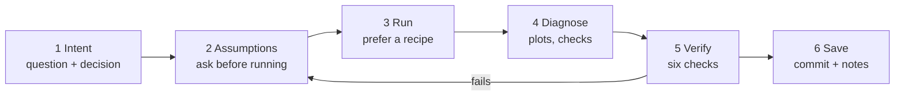

# L0.2 · The vibe-coding playbook for analytics

Day 0 · Basic → Advanced 60 min · Leader 40 min · Prerequisites: L0.1

**Objectives** — by the end you can: structure a request so Claude Code does the right analysis; make it state assumptions
before running; verify a result with the six-check protocol; and recognise the eight most common AI-generated statistical errors.

## 1. Business question

> "Claude Code gave me a number in ten seconds. **Can I put it in front of the category director?**"

The answer is never "yes, it came from the AI". It is "yes, because I checked it" — this lesson teaches how.

## 2. The loop

## 3. Concept

=== "Basic → Advanced"

    ### Anatomy of an expert analysis prompt (CQ-DMCOA)

    | Part | Say… | Example |
    | --- | --- | --- |
    | **C**ontext | who you are, which data | "I'm analysing NorthStar's Hair Care store test in `weekly_store_category`." |
    | **Q**uestion | the business question and the decision | "Did the feature promotion lift units enough to roll out (needs ≥ 5%)?" |
    | **D**ata | grain, filters, unit of analysis | "Stores were randomised; analyse one row per store." |
    | **M**ethod constraints | what to use / avoid | "Use the two-group test recipe; compare growth vs each store's pre-period." |
    | **C**hecks | assumptions and diagnostics to show | "Check randomisation balance, skew, and show the Q-Q plot." |
    | **O**utput | tables, plots, files | "Save to `outputs/`; give effect size with 95% CI." |
    | **A**udience | who reads it | "Explain in 5 bullets for a category manager." |

    ### Make it state assumptions **before** running

    Add one sentence to every analytical prompt: **"Before running anything, state the unit of analysis, the method you will use,
    its assumptions, and what you will do if an assumption fails. Wait for my OK."** This one habit prevents most wrong-test errors.

    ### The six-check verification protocol

    | # | Check | How to ask |
    | --- | --- | --- |
    | 1 | **Row accounting** — rows in, removed at each step, analysed | "Show rows before and after every filter and why." |
    | 2 | **Reproduce a key number two ways** | "Recompute the lift with a simple groupby, not the recipe." |
    | 3 | **Sanity vs known totals** | "Does total revenue match the data card / last month's report?" |
    | 4 | **Look at the plot** | "Show the distribution / residuals before the test result." |
    | 5 | **Assumption diagnostics** | "Which assumptions did you check and what did they show?" |
    | 6 | **Challenge** | "What would change this conclusion? What else could explain it?" |

=== "Leader"

    **Refresh:** the loop is intent → assumptions → run → diagnose → verify → save. Your juniors will produce answers far faster
    than before; your value moves from *producing* analyses to *judging* them.

    **What to look for when a junior shows you AI-generated work:**

    | Red flag | Question to ask | Why it matters |
    | --- | --- | --- |
    | No row counts | "How many rows went in, and how many were analysed?" | Silent drops (nulls, joins) change answers |
    | p-value without effect size | "How big is it, with what interval?" | Significant ≠ important |
    | Unit of analysis unclear | "What was randomised — lines, customers, stores?" | Wrong unit = falsely precise |
    | No assumption checks | "What did the diagnostics show?" | Tests can be invalid |
    | A number you cannot trace | "Show me the file it came from." | Hallucinated or stale numbers |
    | Perfect result | "What did you try that didn't work?" | p-hacking, forking paths |

    !!! tip "Coaching card — the 3 questions"
        When a junior brings you any number, ask in this order: **(1) Where did it come from?** (file, config, rows)
        **(2) How sure are we?** (interval, assumptions) **(3) What would change your mind?** (alternative explanations).
        Make the junior ask Claude Code the same three questions *before* they come to you.

    **Team standard to draft (Day 0 gate):** one paragraph defining what "checked" means for AI-assisted analysis in your team.

## 4. Prompt cards

**Weak:** "do a t test on the promo data"

**Better:** "Test whether test stores sold more Hair Care units than control stores during weeks 70–77."

**Expert:** "Context: NorthStar store-level Hair Care feature-promotion test, `data/retail/weekly_store_category.parquet`.
Question: did the promotion lift units enough to roll out (minimum 5%)? Stores were randomised 20/20 within format, so analyse
one row per store. Use `rcp_two_group_test` with growth versus each store's weeks 54–69 average. **Before running, state the unit
of analysis, the test, its assumptions and the fallback; wait for my OK.** Then show row accounting, the effect with 95% CI, the
Q-Q plot, and five bullets for a category manager. Do not quote any number that is not in the output files."

??? tip "🛠 Learn by doing — optional vibe-coding lab (15–20 min)"
    1. Ask Claude Code: "Before you compute anything, state your assumptions: what is one row of `transactions`, and which rows would you exclude from revenue?"
    2. Ask it to compute average basket value, then ask: "How many rows did you drop and why?"
    3. Change one thing: give a deliberately vague prompt ("analyse sales") and compare the answer with an expert prompt.
    4. Explain it back: which of the AI error-catalogue mistakes did you catch?

## 5. The AI statistical-error catalogue

| # | Error | Typical symptom | How to catch it |
| --- | --- | --- | --- |
| 1 | **Wrong test for the data** | t-test on a 0/1 outcome or on clustered rows | Ask for the unit of analysis and outcome type first |
| 2 | **Data leakage** | AUC 0.98 on credit data | Ask "when is each field known?" |
| 3 | **p-hacking** | Many segments tested, only winners reported | Ask "how many tests did you run in total?" |
| 4 | **Ignored assumptions** | No diagnostics shown | Ask for the plots before the verdict |
| 5 | **Silently dropped rows** | n smaller than expected | Demand row accounting |
| 6 | **Correlation read as causation** | "Loyalty causes +40% spend" | Ask "was it randomised? what else differs?" |
| 7 | **One-metric over-trust** | Accuracy 99% on 1% fraud | Ask for the base rate and a second metric |
| 8 | **Hallucinated results** | A number with no file behind it | Ask "which output file contains that number?" |

## 6. Exercises

1. **(F)** Rewrite the weak prompt "check the bank data for problems" into an expert prompt using CQ-DMCOA. Run it. Did Claude Code state assumptions first?
2. **(F)** Ask Claude Code for the 12-month default rate. Then reproduce it with a different method (e.g. count defaulters ÷ count
   accounts). The answer should be 4.0%. If the two differ, find out why.
3. **(F)** Ask Claude Code a question that *cannot* be answered from the data (e.g. "what was NorthStar's market share?"). Does it say so, or invent an answer?
4. **(L)** Take an AI-generated paragraph from Exercise 1 and annotate it with the six checks: which were done, which missing?

## 7. Quiz

=== "Basic → Advanced"

    

=== "Leader"

    

??? info "Instructor area"
    - Live demo: ask Claude Code exercise 3 in front of the room. If it invents an answer, use it as the anchor example for error #8.
    - Rubric for the leaders' team standard: names row accounting, effect size + CI, assumption checks, reproducibility, and who signs off.

