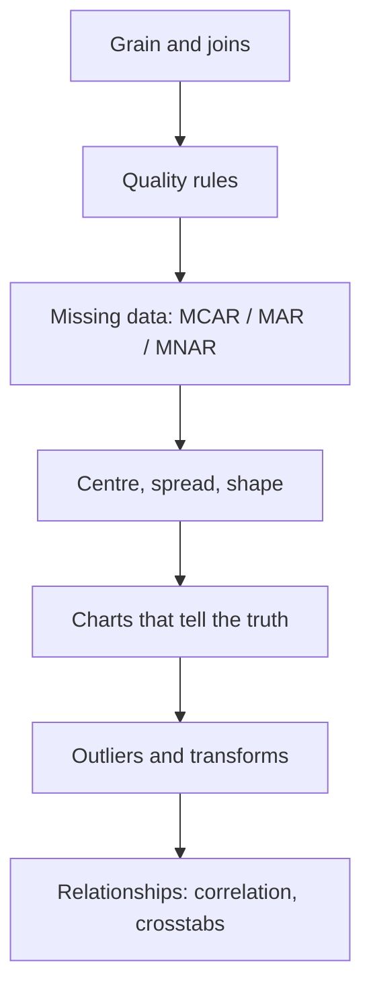

# Day 1 · Data quality and descriptive statistics { .sb-day-title }

**Part A — Descriptive.** Before any test or model: what does one row mean, can the data be trusted, what is missing and why,
and how do we summarise and picture what we have — honestly?

## Today's mental map

See where today sits in the [big picture](../maps/index.md).

| Lesson | Title | Time (Basic→Adv / Leader) | Navigator node | Planted issues met |
| --- | --- | --- | --- | --- |
| [L1.1](L1-1.md) | Data types, grain, tidy data, EDA workflow | 60 / 25 min | `N-DESC-PROFILE` | — (join explosion drill) |
| [L1.2](L1-2.md) | Data-quality checks | 75 / 30 min | `N-DESC-QUALITY` | R01, R02, R03, R19, F01 |
| [L1.3](L1-3.md) | Missing data: MCAR, MAR, MNAR | 75 / 35 min | `N-DESC-MISSING` | R04, R05, R06, F02 |
| [L1.4](L1-4.md) | Centre, spread and shape | 60 / 25 min | `N-DESC-SKEW` | R07, F14 |
| [L1.5](L1-5.md) | Visualising distributions | 60 / 25 min | `N-DESC-SKEW` | F11 preview |
| [L1.6](L1-6.md) | Outliers and transformations | 75 / 30 min | `N-DESC-OUTLIER` | R02, R07 |
| [L1.7](L1-7.md) | Relationships: correlation, crosstabs | 60 / 25 min | `N-DESC-CORR` | F04, F06 previews |

**Recipes introduced:** `rcp_quality` (rules, duplicates, missing-data diagnosis) and `rcp_outliers` (rules compared, treatments compared).

## Day 1 gate

Quiz (12 questions, pass 75%) **plus** a data task: run `rcp_quality` on a dataset of your choice from the variants folder,
write a five-bullet quality memo, and log every planted issue you found in the [Anomaly Hunt](../practice/anomaly-hunt.md).

!!! tip "Evening lab (optional)"
    Not scheduled on Day 1 — use the time to finish the Stretch exercises and the Day 0 diagnostic topics you missed.
