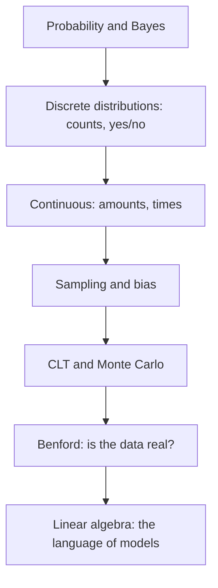

# Day 2 · Probability, distributions, sampling and simulation { .sb-day-title }

**Part A — Descriptive foundations for inference.** The language of uncertainty: conditional probability and base rates, the
distribution family and when each member applies, how samples mislead, why averages behave (the central limit theorem), how to
simulate decisions, how invented numbers betray themselves, and the matrix ideas behind every model.

## Today's mental map

See where today sits in the [big picture](../maps/index.md).

| Lesson | Title | Time (Basic→Adv / Leader) | Navigator | Planted issues met |
| --- | --- | --- | --- | --- |
| [L2.1](L2-1.md) | Probability, conditional probability, Bayes, base rates | 75 / 30 min | `N-METRIC-RARE` | F03 |
| [L2.2](L2-2.md) | Discrete distributions | 60 / 25 min | `N-DIST-NB` | F17 preview |
| [L2.3](L2-3.md) | Continuous distributions and the family map | 75 / 30 min | `N-DIST-AMT` | F17 |
| [L2.4](L2-4.md) | Sampling, bias, Simpson's paradox, confounding | 75 / 35 min | `N-DESC-STRATIFY` | R14, R15, R16, R20, F18 |
| [L2.5](L2-5.md) | Law of large numbers, CLT, Monte Carlo | 75 / 30 min | `N-OPT-MC` | — |
| [L2.6](L2-6.md) | Benford's law and digit tests | 45 / 25 min | `N-ANOM-BENFORD` | R18, F09 |
| [L2.7](L2-7.md) | Linear algebra essentials | 60 / 20 min | `N-REG-VIF` | F06 preview |

**Recipes introduced:** `rcp_distribution_fit` and `rcp_benford`.

## Day 2 gate

## Evening lab (19:00–20:30)

1. Run `rcp_distribution_fit` on three variables of your choice (one count, two amounts) across both datasets, config only.
2. Re-run the Monte Carlo of exercise R2-12 with your own assumptions about rollout cost; find the cost at which P(loss) reaches 50%.
3. Anomaly Hunt: find R14, R16, R18 and F09.
