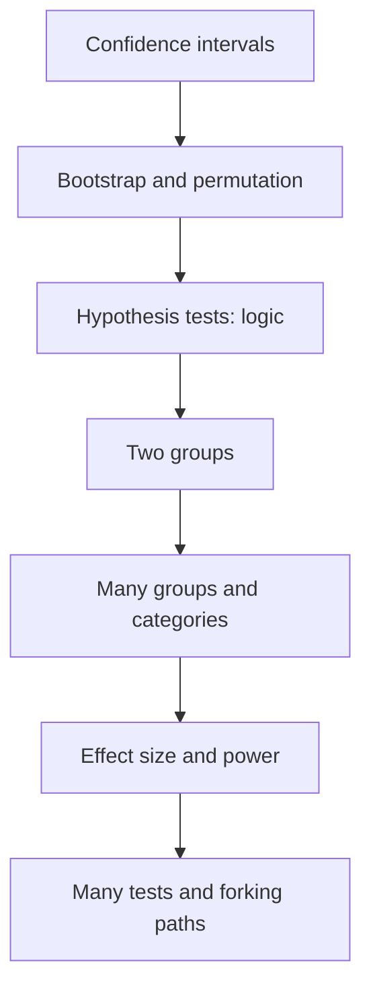

# Day 3 · Estimation and hypothesis testing { .sb-day-title }

**Part B — Analytical.** From "what does the data say?" to "how sure are we, and how big is it?" Intervals for every estimate,
resampling when formulas fail, the logic and limits of p-values, the right test for two or many groups, effect sizes and power,
and the discipline that stops many tests producing false discoveries.

## Today's mental map

See where today sits in the [big picture](../maps/index.md).

| Lesson | Title | Time (Basic→Adv / Leader) | Navigator | Planted issues met |
| --- | --- | --- | --- | --- |
| [L3.1](L3-1.md) | Estimation and confidence intervals | 75 / 30 min | `N-TEST-2G-MEAN` | R07, R03 |
| [L3.2](L3-2.md) | Bootstrap and permutation | 60 / 25 min | `N-TEST-PERM` | — |
| [L3.3](L3-3.md) | Hypothesis-testing logic, p-values, errors | 75 / 30 min | `N-TEST-Q0` | F11 preview |
| [L3.4](L3-4.md) | **Two-group comparison** (reference lesson) | 90 / 40 min | `N-TEST-2G-MEAN` | R09, R24, F16 |
| [L3.5](L3-5.md) | More than two groups and categorical tests | 75 / 30 min | `N-TEST-KG` | F15 preview |
| [L3.6](L3-6.md) | Effect sizes, power, sample size | 75 / 35 min | `N-EXP-POWER` | F16 |
| [L3.7](L3-7.md) | Multiple testing and p-hacking | 60 / 30 min | `N-TEST-MULTI` | S43 |

**Recipes introduced:** `rcp_two_group_test` (L3.4), `rcp_multi_group_test` and `rcp_power`.

## Day 3 gate

## Evening lab (19:00–20:30)

1. Write a one-page pre-registration for a Snacks fixture test, then size it with `rcp_power` (config only).
2. Re-run `rcp_two_group_test` on the e-coupon data (R24) — before reading the result, check the assignment counts. What do you see?
3. Anomaly Hunt: find R09, R24 and F16; explain why each needs the store/user/account as the unit.
