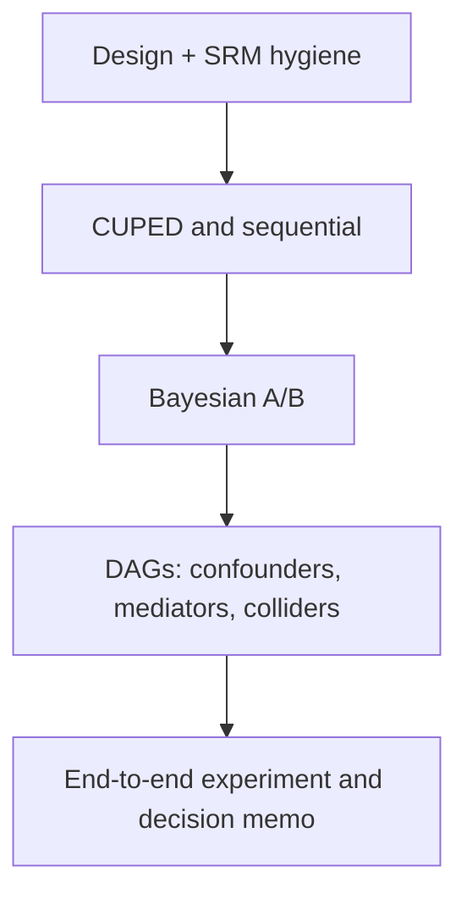

# Day 4 · Experiments and causal basics { .sb-day-title }

**Part B — Analytical.** Designing tests that can be trusted, reading them in the right order (hygiene → effect → guardrails →
decision), getting more precision from history (CUPED), monitoring safely (sequential designs), speaking in probabilities
(Bayesian A/B), and thinking causally when you cannot randomise (DAGs).

## Today's mental map

See where today sits in the [big picture](../maps/index.md).

| Lesson | Title | Time (Basic→Adv / Leader) | Navigator | Planted issues met |
| --- | --- | --- | --- | --- |
| [L4.1](L4-1.md) | A/B test design and hygiene | 75 / 35 min | `N-EXP-SRM` | R24 |
| [L4.2](L4-2.md) | CUPED and sequential testing | 60 / 30 min | `N-EXP-CUPED` | R09, R24 |
| [L4.3](L4-3.md) | Bayesian thinking and Bayesian A/B | 60 / 30 min | `N-BAYES-AB` | R24, F11 preview |
| [L4.4](L4-4.md) | Causal basics: DAGs, confounders, colliders | 75 / 35 min | `N-CAUSAL-DAG` | R14, R15, F18 |
| [L4.5](L4-5.md) | Store-level and champion/challenger tests end to end | 90 / 45 min | `N-EXP-Q1` | R09, F16 |

**Recipe introduced:** `rcp_ab_test`.

## Day 4 gate

## Evening lab (19:00–20:30)

1. Write the decision memo for the e-coupon test (including the SRM) using the L4.5 template.
2. Draw DAGs for three questions from your own work; mark confounders, mediators and colliders.
3. Anomaly Hunt: find R14, R15, R24 and F18 and say which Day 4 tool exposes each.
