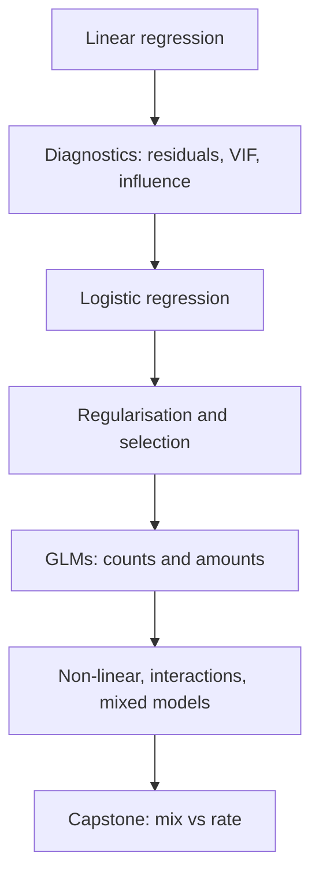

# Day 5 · Regression and generalised linear models { .sb-day-title }

**Part B — Analytical.** Explaining outcomes with several drivers at once: linear regression and its business reading, the
diagnostics that decide whether to trust it, logistic regression for yes/no outcomes, regularisation and model selection, GLMs for
counts and amounts, non-linear and grouped effects — and a capstone that takes a vague "why did it change?" to a defensible answer.

## Today's mental map

See where today sits in the [big picture](../maps/index.md).

| Lesson | Title | Time (Basic→Adv / Leader) | Navigator | Planted issues met |
| --- | --- | --- | --- | --- |
| [L5.1](L5-1.md) | Linear regression and coefficient interpretation | 75 / 30 min | `N-REG-OLS` | R11 |
| [L5.2](L5-2.md) | Regression diagnostics | 75 / 30 min | `N-REG-VIF` | F06 |
| [L5.3](L5-3.md) | Logistic regression | 75 / 30 min | `N-REG-LOGIT` | F03 |
| [L5.4](L5-4.md) | Regularisation and model selection | 60 / 25 min | `N-REG-VIF` | F06 |
| [L5.5](L5-5.md) | GLMs: Poisson, NB, Gamma, Tweedie, quantile | 75 / 30 min | `N-REG-GLM` | F17 |
| [L5.6](L5-6.md) | Non-linearity, interactions, mixed models | 75 / 30 min | `N-REG-INTERACT` | F04, F05 |
| [L5.7](L5-7.md) | **Part A/B checkpoint capstone** | 120 / 60 min | `N-REG-Q1` | R01–R03, F11 |

**Recipe introduced:** `rcp_regression` (OLS, logistic, Poisson, negative binomial, Gamma; joins and claim counts in the config).

## Day 5 gate

## Evening lab (19:00–20:30)

1. Run `rcp_regression` on Frozen and Bakery with the Beverages config (category filter only) and compare temperature effects.
2. Build the frequency × severity pure premium for home policies.
3. Leaders: review a partner's capstone with the six-point checklist in L5.7.
