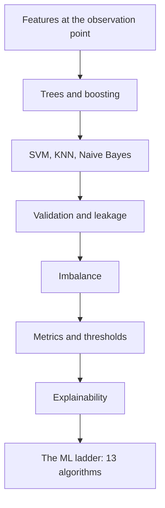

# Day 6 · Machine learning for prediction { .sb-day-title }

**Part B — Analytical.** Building predictive models that hold up: features that respect time, trees and ensembles against a logistic
baseline, the alternatives and when they matter, honest validation (leakage, out-of-time, tuning), rare events, metrics and
thresholds that match decisions, and explanations for customers, regulators and reviewers.

## Today's mental map

See where today sits in the [big picture](../maps/index.md).

| Lesson | Title | Time (Basic→Adv / Leader) | Navigator | Planted issues met |
| --- | --- | --- | --- | --- |
| [L6.1](L6-1.md) | Feature engineering and selection | 60 / 25 min | `N-ML-Q1` | F02 |
| [L6.2](L6-2.md) | Trees, random forests, gradient boosting | 75 / 30 min | `N-ML-GBM` | F04, F05 |
| [L6.3](L6-3.md) | SVM, KNN, Naive Bayes, ensembling | 45 / 20 min | `N-ML-Q1` | — |
| [L6.4](L6-4.md) | Validation, tuning, bias–variance, leakage | 75 / 35 min | `N-ML-LEAK` | F10, F11 |
| [L6.5](L6-5.md) | Class imbalance | 60 / 25 min | `N-ML-IMBALANCE` | F03, F07 |
| [L6.6](L6-6.md) | Evaluation metrics and thresholds | 75 / 35 min | `N-METRIC-COST` | S28 |
| [L6.7](L6-7.md) | Explainability | 60 / 30 min | `N-ML-SCORECARD` | F15 preview |
| [L6.8](L6-8.md) | The ML ladder: 13 algorithms, one business problem at a time | 75 / 30 min | `N-ML-Q1` | — |

**Recipe introduced:** `rcp_classifier`.

## Day 6 gate

## Evening lab (19:00–20:30)

1. Run the four classifier configs; write one paragraph per run on what you'd tell the credit committee.
2. Add shared-device counts to the fraud model and report precision@100.
3. Anomaly Hunt: find F10 and explain how you'd catch it in code review.
