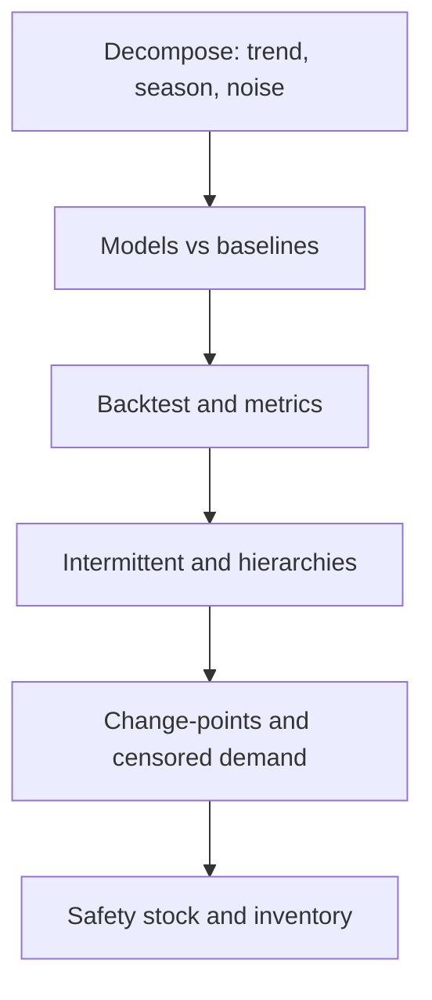

# Day 7 · Time series, forecasting and inventory { .sb-day-title }

**Part B — Analytical.** Reading patterns over time, forecasting them honestly against baselines, measuring accuracy at the level
decisions are made, handling the long tail and hierarchies, spotting breaks and censored demand, and turning forecasts into stock and
capacity decisions.

## Today's mental map

See where today sits in the [big picture](../maps/index.md).

| Lesson | Title | Time (Basic→Adv / Leader) | Navigator | Planted issues met |
| --- | --- | --- | --- | --- |
| [L7.1](L7-1.md) | Decomposition, stationarity, ACF/PACF | 60 / 25 min | `N-FCST-SEASON` | R11, F11 |
| [L7.2](L7-2.md) | ETS, ARIMA/SARIMA, Prophet-style | 75 / 30 min | `N-FCST-DRIVERS` | R11 |
| [L7.3](L7-3.md) | Backtesting and forecast metrics | 60 / 25 min | `N-METRIC-REG` | — |
| [L7.4](L7-4.md) | Intermittent and hierarchical forecasting | 60 / 25 min | `N-FCST-INTERMITTENT` | R22 |
| [L7.5](L7-5.md) | Change-points and censored demand | 60 / 25 min | `N-FCST-BREAK` | R08, R12 |
| [L7.6](L7-6.md) | Inventory: safety stock, service level, ABC/XYZ | 60 / 30 min | `N-OPT-INVENTORY` | R12, R22 |

**Recipes introduced:** `rcp_forecast`, `rcp_changepoint`, `rcp_inventory`.

## Day 7 gate

## Evening lab (19:00–20:30)

1. Run `rcp_forecast` for three categories (filter only) and compare which beat seasonal naive.
2. Propose differentiated service levels from `rcp_inventory` and estimate the stock saving.
3. Anomaly Hunt: find R08, R11, R12 and R22.
