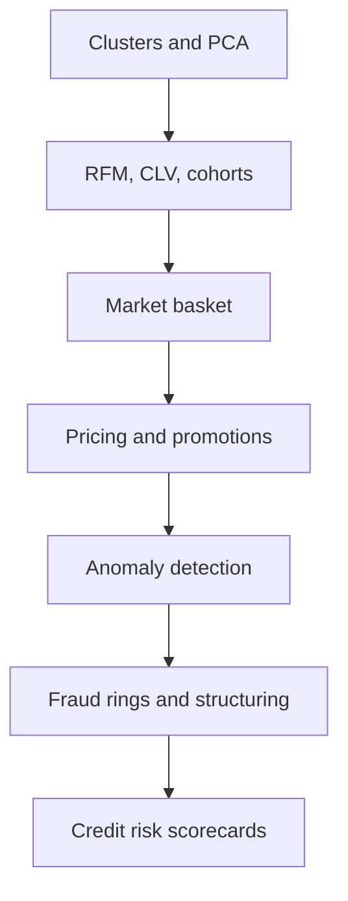

# Day 8 · Segmentation, pricing and risk analytics { .sb-day-title }

**Part C — Domain.** Turning the methods of Days 1–7 into the analyses retail and banking teams run every week: customer segments
and value, basket affinities, price and promotion economics, anomaly and fraud detection, and credit scorecards.

## Today's mental map

See where today sits in the [big picture](../maps/index.md).

| Lesson | Title | Time (Basic→Adv / Leader) | Navigator | Planted issues met |
| --- | --- | --- | --- | --- |
| [L8.1](L8-1.md) | Clustering and PCA | 60 / 25 min | `N-CLUST-KMEANS` | R18 |
| [L8.2](L8-2.md) | RFM, customer lifetime value and cohorts | 60 / 25 min | `N-SEG-RFM` | R07, F13 |
| [L8.3](L8-3.md) | Market basket analysis | 45 / 20 min | `N-SEG-BASKET` | R21 |
| [L8.4](L8-4.md) | Pricing, promotions and marketing mix | 75 / 30 min | `N-REG-LOGLOG` | R10 |
| [L8.5](L8-5.md) | Anomaly detection | 60 / 25 min | `N-ANOM-MULTI` | R17 |
| [L8.6](L8-6.md) | Fraud analytics: rings and structuring | 45 / 25 min | `N-ANOM-GRAPH` | F07, F08 |
| [L8.7](L8-7.md) | Credit risk: scorecards, PD/LGD/EAD, vintages, roll rates | 75 / 30 min | `N-ML-SCORECARD` | F02, F09, F16 |

**Recipes introduced:** `rcp_cluster`, `rcp_basket`, `rcp_elasticity`, `rcp_anomaly_scan`, `rcp_scorecard`.

## Day 8 gate

## Evening lab (19:00–20:30)

1. Rerun `rcp_elasticity` for a third category (change only the filter) and write a one-paragraph price recommendation.
2. Lower the `rcp_anomaly_scan` contamination to fit a review budget of 20 cases a week; report the expected confirmation rate.
3. Anomaly Hunt: find R10, R17, R21, F07 and F08.
