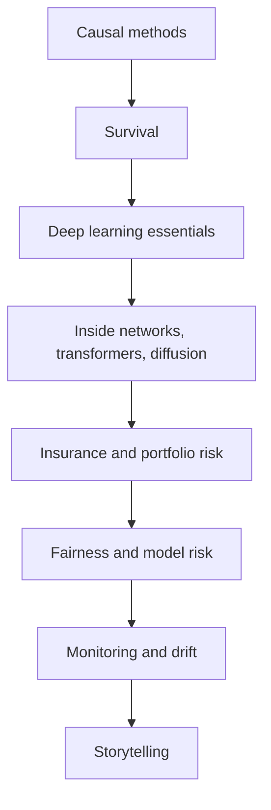

# Day 9 · Advanced methods: causality, survival, AI, risk, fairness and monitoring { .sb-day-title }

**Part B — Advanced.** The methods that separate a competent analyst from a trusted one: defensible causal claims without a test,
time-to-event analysis, an honest view of deep learning and LLMs, tail risk and capital, fairness and uncertainty, keeping models healthy
in production — and telling the story so a decision gets made.

## Today's mental map

See where today sits in the [big picture](../maps/index.md).

| Lesson | Title | Time (Basic→Adv / Leader) | Navigator | Planted issues met |
| --- | --- | --- | --- | --- |
| [L9.1](L9-1.md) | Causal methods: DiD, matching, uplift, RDD, synthetic control | 75 / 30 min | `N-CAUSAL-DID` | R09, R20 |
| [L9.2](L9-2.md) | Survival analysis: Kaplan–Meier, log-rank, Cox | 60 / 25 min | `N-TEST-SURV` | F13 |
| [L9.3](L9-3.md) | Deep learning essentials and modern AI | 60 / 30 min | `N-ML-DL` | — |
| [L9.4](L9-4.md) | Insurance and portfolio risk: frequency–severity, VaR, ES, stress tests | 60 / 30 min | `N-REG-GLM-INS` | F17 |
| [L9.5](L9-5.md) | Fairness, responsible AI and model risk | 60 / 30 min | `N-MON-FAIR` | F15 |
| [L9.6](L9-6.md) | Monitoring and drift | 60 / 30 min | `N-MON-PSI` | R19, F11, F12, F18 |
| [L9.7](L9-7.md) | Data storytelling and executive readouts | 45 / 45 min | `N-CAUSAL-ROOT` | — |
| [L9.8](L9-8.md) | Inside neural networks, transformers and diffusion models | 75 / 30 min | `N-ML-DL` | — |

**Recipe introduced:** `rcp_drift` — the toolkit is now complete (20 working recipes).

## Day 9 gate

## Evening lab (19:00–20:30)

1. Run a placebo DiD (Personal Care) and add it to your Hair Care evidence.
2. Schedule-ready monitoring: copy `finance_drift_vintage.yaml`, change the windows to the last two quarters and write the one-paragraph
   monitoring note.
3. Draft the CRO default readout with Claude Code, then verify every number against the output files.
4. Anomaly Hunt: find R09, R19, R20, F11, F12, F13, F15, F17 and F18.
