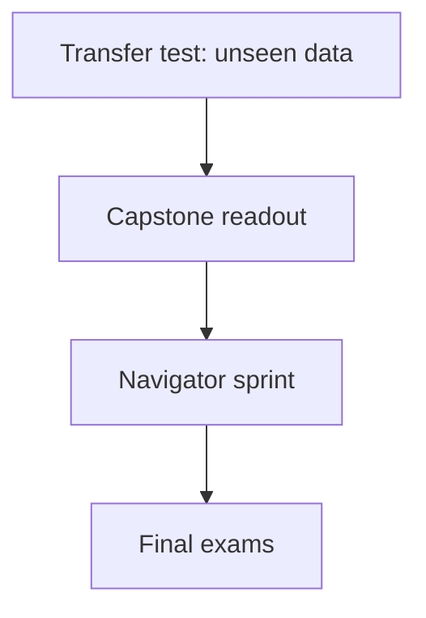

# Day 10 · Transfer, capstone and assessment { .sb-day-title }

**Parts A + B.** Prove the skills transfer: an unseen dataset in a new domain, an open-ended business question defended to a panel, a
Navigator sprint, and the final exams on held-out data.

## Today's mental map

See where today sits in the [big picture](../maps/index.md).

| Lesson | Title | Time (Basic→Adv / Leader) | Navigator | Assessment |
| --- | --- | --- | --- | --- |
| [L10.1](L10-1.md) | Transfer test: an unseen quick-commerce dataset | 120 / 60 min | `N-DESC-PROFILE` | rubric ≥ 3/5 per criterion |
| [L10.2](L10-2.md) | Final capstone: business readouts | 150 / 90 min | `N-CAUSAL-ROOT` | rubric ≥ 3 each, ≥ 18 total |
| [L10.3](L10-3.md) | Navigator consolidation: scenario sprint | 60 / 45 min | all trees | sprint quiz |
| [L10.4](L10-4.md) | Final exam and code-review exam | 120 / 120 min | all trees | 75%; Leaders ≥ 5/7 flaws |

## Completion

| Requirement | Basic → Advanced | Leader |
| --- | --- | --- |
| Day gates 1–9 | ✅ 75% | ✅ 75% |
| Transfer test | rubric ≥ 3 each | same + reuse review |
| Capstone | rubric pass | panel member + own readout |
| Final exam A + B | 75% | 75% |
| Code-review exam | optional | ≥ 5 of 7 flaws + right decision |
| Anomaly Hunt | ≥ 34 of 42 | ≥ 30 of 42 reviewed |

## Day 10 gate

The final exam (L10.4 Part A) is the Day 10 gate.
