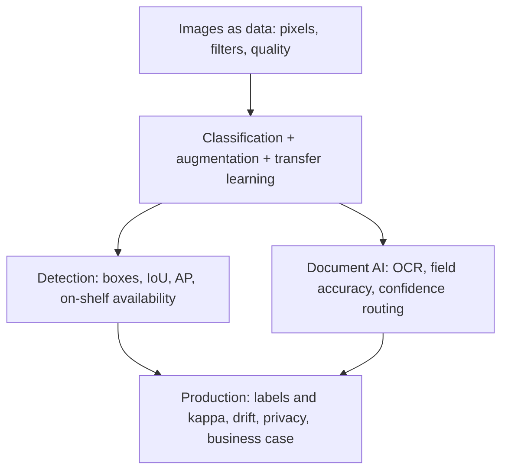

# Day 11 · Computer vision analytics (optional module) { .sb-day-title }

**For learners who want to apply the course to images and scanned documents.** Everything runs on a laptop with images generated
for the course (NorthStar shelf photos) and real handwritten digits bundled with scikit-learn (Meridian cheque amounts).

!!! info "In plain words"
    Computer vision is statistics and machine learning on grids of numbers. Everything you learned about validation, rare events,
    thresholds, drift and fairness applies — with a few new tools: filters, augmentation, pretrained models and box overlap (IoU).

## Today's mental map

| Lesson | Title | Time (Basic→Adv / Leader) | Planted issues met |
| --- | --- | --- | --- |
| [L11.1](L11-1.md) | Images as data: pixels, filters and features | 60 / 25 min | V1, V2 |
| [L11.2](L11-2.md) | Image classification, augmentation and transfer learning | 75 / 30 min | V1, V2 |
| [L11.3](L11-3.md) | Object detection: gaps, IoU, precision–recall, on-shelf availability | 75 / 30 min | V1 |
| [L11.4](L11-4.md) | Document AI: reading cheque amounts and knowing when not to trust it | 60 / 30 min | — |
| [L11.5](L11-5.md) | Computer vision in production: labels, drift, privacy, business case | 45 / 45 min | V1, V2, V3 |

**Planted vision issues:** V1 a store camera goes dim from week 5 · V2 a camera out of focus · V3 an annotator who mislabels ~8%.

**Going further (optional, needs PyTorch and a model download):** the transfer-learning prompt in L11.2 fine-tunes a pretrained
ResNet; production detectors (YOLO, Faster R-CNN) and OCR engines follow the evaluation you learn here.

## Day 11 gate

