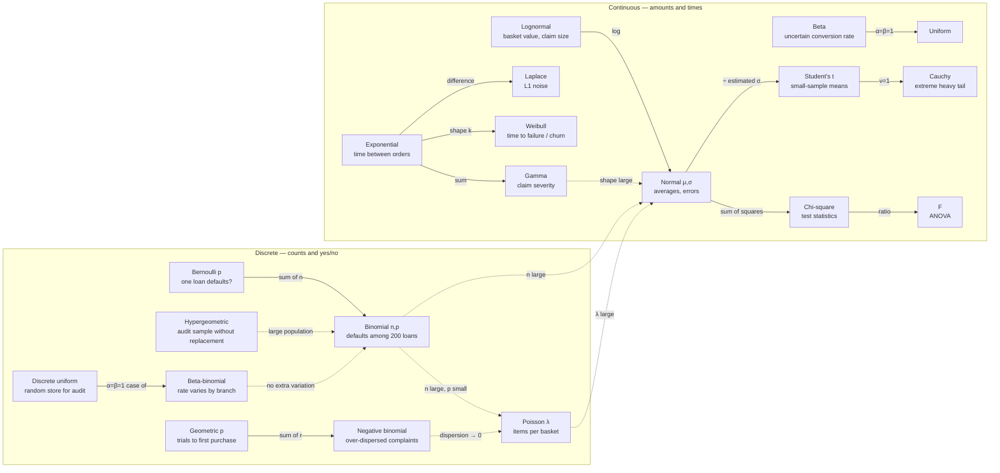

# Mental map · Probability distributions

A distribution is a **shape for uncertainty**. Choose it by *what is being counted or measured*, not by name — then check the fit.
Most distributions are relatives: special cases, transformations or limits of each other.

Solid arrows: exact special case or transformation. Dotted: limit (approximation as a parameter grows).

## Choose by what you are modelling

| You are modelling… | First choice | Retail example | Finance example | Check | Fallback |
| --- | --- | --- | --- | --- | --- |
| a yes/no outcome | Bernoulli / Binomial | coupon redeemed | loan defaults | rate stable across groups? | Beta-binomial |
| counts per period | Poisson | items per basket | transactions per day | variance ≈ mean? | Negative binomial |
| over-dispersed counts | Negative binomial | stock-outs per store-week | complaints per branch | dispersion > 1 | zero-inflated models |
| sampling from a finite list | Hypergeometric | auditing 50 of 400 invoices | sampling loan files | — | Binomial if population large |
| trials until success | Geometric | visits until first purchase | calls until a promise to pay | constant probability? | NB |
| positive, right-skewed amounts | Lognormal / Gamma | basket value | claim size, income | Q-Q plot on log scale | mixture, empirical |
| time between events | Exponential | time between online orders | time between card swipes | constant hazard? | Weibull |
| time to failure / churn | Weibull | time to repeat purchase | months to account closure | hazard rising/falling? | Kaplan–Meier (no shape) |
| every outcome equally likely | Discrete uniform | random store chosen for an audit | random account picked for a quality check | — | — |
| a probability that is uncertain | Beta | conversion rate prior | default-rate prior for a new segment | — | — |
| averages, model errors | Normal | mean basket of 100 shoppers | portfolio average loss | Q-Q plot, n large | t, bootstrap |
| very heavy tails | Student's t / Cauchy | — | market returns, fraud amounts | tail plot | extreme-value models |
| test statistics | Chi-square, F, t | — | — | — | simulation |

Try them: [Poisson, Binomial, NB sliders](../day-02/L2-2.md) · [Lognormal tail slider](../day-02/L2-3.md) · [CLT simulator](../day-02/L2-5.md).
