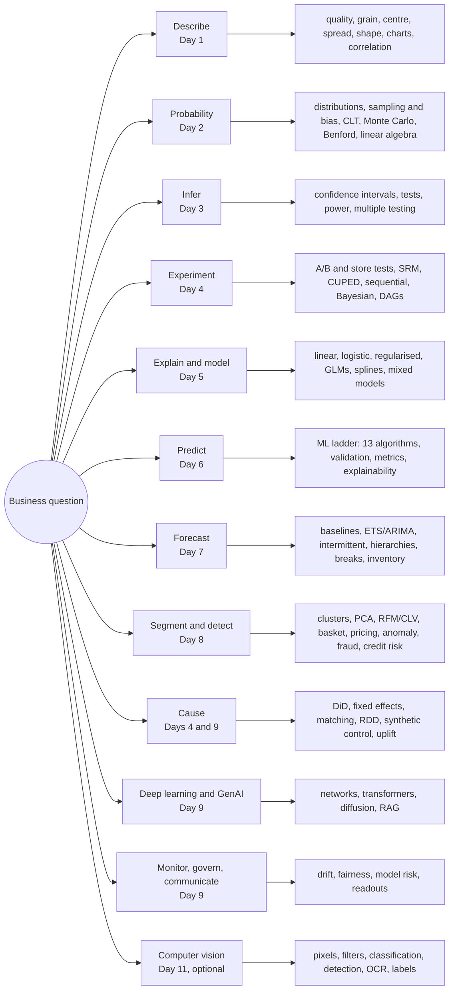

# Mental maps — the big picture

A mental map answers one question: **"I have this business problem — which family of techniques do I reach for?"** Before learning
any single method, look at where it sits. Every day of the course starts with its own map, and every lesson shows
"📍 You are here" on the [Navigator](../navigator/index.md).

## The whole field on one page

## The ten questions behind every analysis

| If the business asks… | Family | Day | Detailed map |
| --- | --- | --- | --- |
| "Is the data right? What does it look like?" | Describe | 1 | [Navigator: describe](../navigator/trees.md) |
| "What values are likely? How rare is this?" | Probability & distributions | 2 | [Distributions map](distributions.md) |
| "Is this difference real or noise?" | Inference & tests | 3 | [Test chooser map](tests.md) |
| "Did our change work?" (we can randomise) | Experiments | 4 | [Test chooser map](tests.md) |
| "What drives Y, and by how much?" | Regression & GLMs | 5 | [Regression map](regression.md) |
| "Who will default / churn / buy?" | Machine learning | 6, 9 | [ML ladder](ml.md) · [Deep learning & GenAI](deep-learning.md) |
| "How much next week / month?" | Forecasting | 7 | [More maps → forecasting](more-maps.md#forecasting) |
| "Which groups exist? What is unusual?" | Segmentation & anomaly | 8 | [More maps → segment & detect](more-maps.md#segment-and-detect) |
| "Did X *cause* Y?" (we couldn't randomise) | Causal inference | 4, 9 | [More maps → causal](more-maps.md#causal-inference) |
| "Is the model still OK and fair?" | Monitoring & governance | 9 | [More maps → monitoring](more-maps.md#monitoring-and-governance) |
| "What is on the shelf / in this scanned document?" | Computer vision | 11 | [Deep learning & GenAI → vision](deep-learning.md#computer-vision) |

## How to use the maps

1. **Start from the decision**, not the method: what will someone do differently with the answer?
2. **Name the outcome type** — continuous (revenue), binary (default yes/no), count (complaints), time-to-event (churn), category.
3. **Follow the branch** to a family, then a technique; check its assumption; know its fallback.
4. **Climb only as high as you need.** A simpler technique that answers the question beats a complex one that impresses.
