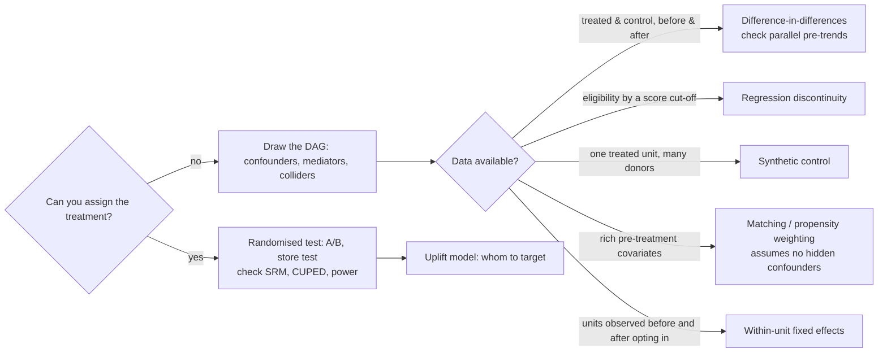
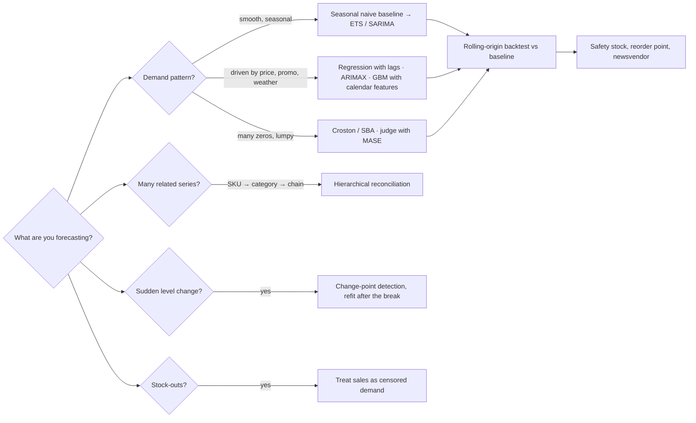
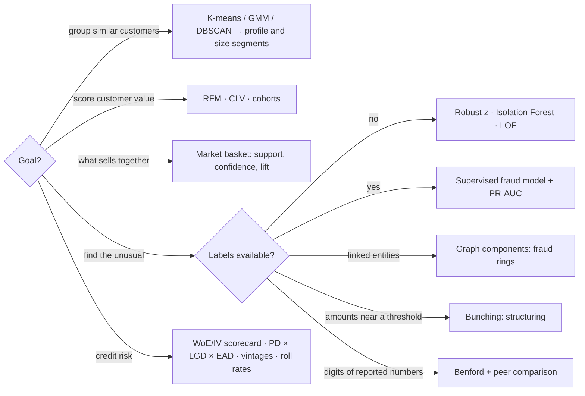
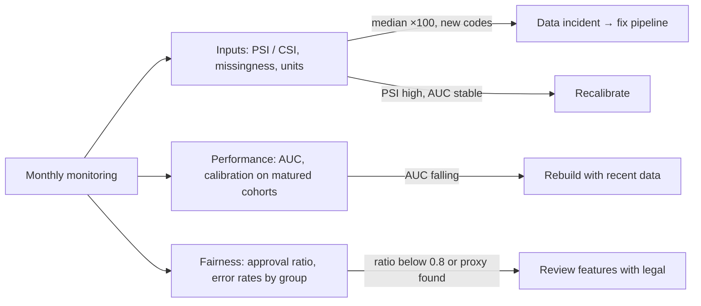
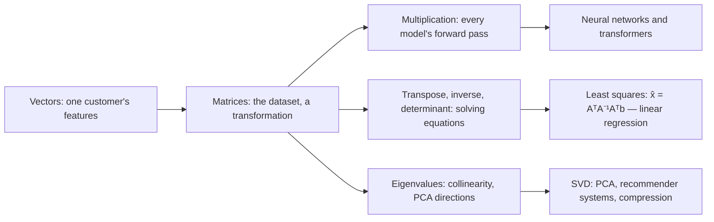

# More mental maps

## Causal inference



| Design | Retail example | Finance example |
| --- | --- | --- |
| Randomised test | e-coupon A/B; Hair Care store test | champion/challenger collections strategy |
| DiD | promotion in 20 test stores vs 20 controls | new branch process in one region |
| Fixed effects | loyalty joiners before vs after joining | customers before/after a limit increase |
| RDD | free delivery above a basket threshold | limit increase above score 650 |
| Synthetic control | one city's new pricing | one country's regulation change |
| Uplift | whom to send a retention coupon | whom to offer a hardship plan |

## Forecasting



## Segment and detect



## Which metric?

```mermaid
flowchart LR
  M{Model output} -->|probability, ranking| AUC[AUC / Gini, KS, lift by decile]
  M -->|rare positives, fixed review team| PR[Precision@k, PR-AUC, recall at capacity]
  M -->|probabilities used as numbers| CAL[Calibration curve, Brier score]
  M -->|decision with costs| COST[Expected-cost threshold]
  M -->|a number| REG[MAE, RMSE, WAPE]
  M -->|a forecast| FC[MASE vs seasonal naive, bias]
```

## Monitoring and governance



## Linear algebra under the hood



Rotate and stretch matrices yourself: [matrix transformation explorer](../day-02/L2-7.md).
