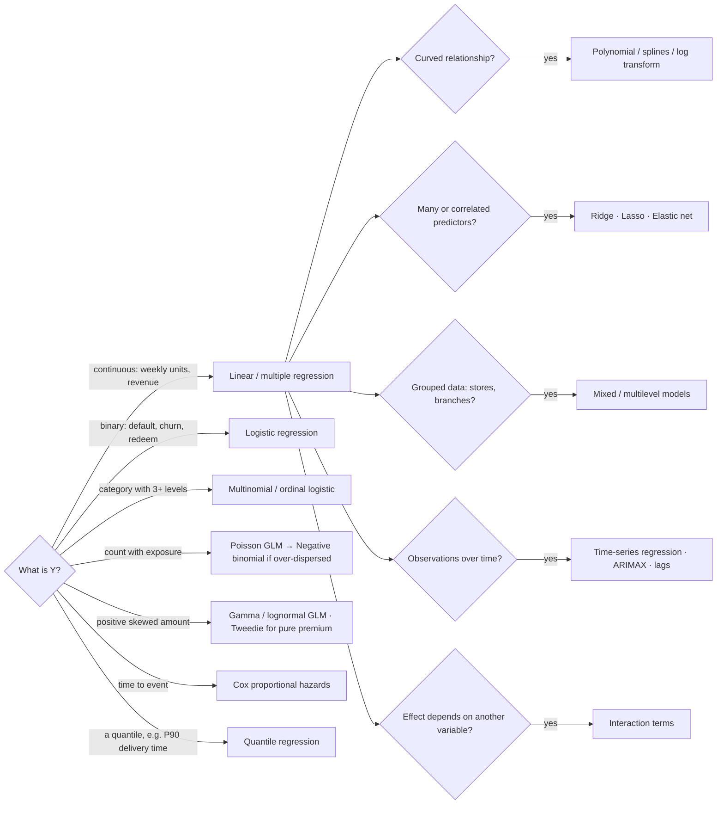

# Mental map · The regression family

Regression answers *"how does Y change when X changes, holding other things constant?"* The family member is chosen by the
**type of Y** and the **structure of the data**.

| Member | Use when | Retail example | Finance example | Watch out for |
| --- | --- | --- | --- | --- |
| Linear | continuous Y, roughly linear | units vs temperature and price | credit limit vs income | heteroscedasticity → log Y |
| Multiple | several drivers | Beverages units ~ price + temp + holiday | loss ~ DTI + utilisation + bureau | multicollinearity (VIF) |
| Polynomial / splines | curved effects | promo depth with diminishing returns | default risk vs utilisation (hockey stick) | overfitting at the edges |
| Ridge / Lasso | many, correlated predictors | 40 store attributes | 40 candidate credit variables | standardise first; tune λ by CV |
| Logistic | binary Y | will this customer redeem? | will this account default? | odds ratios ≠ risk ratios |
| Poisson / NB GLM | counts with exposure | returns per store-week | claims per policy-year | over-dispersion → NB |
| Gamma / Tweedie | positive skewed amounts | basket value | claim severity, pure premium | large-loss loading |
| Mixed models | grouped data | random store intercepts | branch effects | few groups |
| Time-series regression | temporal data | sales with lags and seasonality | balances with macro drivers | autocorrelation |
| Cox | time to event with censoring | time to repeat purchase | time to churn | proportional hazards |
| Quantile | the tail matters | P90 delivery time | P95 loss | — |

See it: [3-D regression plane (rotate it)](../day-05/L5-1.md) · [overfitting slider](../day-05/L5-4.md) · [logistic threshold](../day-05/L5-3.md).
