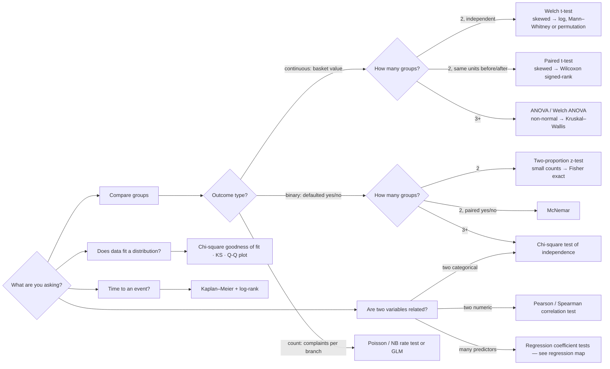

# Mental map · Which statistical test?

Every test answers the same question — *"could this pattern be chance?"* — for a particular **outcome type**, **number of
groups** and **design**. Pick by those three, check the assumption, and always report the **effect size and its interval**, not
just the p-value.

## The test catalogue

| Test | Question it answers | Key assumption | Retail example | Finance example | If the assumption fails |
| --- | --- | --- | --- | --- | --- |
| One-sample z / t | Is the mean different from a target? | approx. normal mean (CLT) | Average basket vs the 40-unit plan | Average utilisation vs policy limit 30% | bootstrap CI |
| Welch two-sample t | Do two group means differ? | independent units; unequal variances OK | Promo vs non-promo store growth | Branch vs online loan size | log scale, Mann–Whitney, permutation |
| Paired t | Did the same units change? | differences roughly normal | Same stores before/after a refit | Same customers' balances before/after a rate change | Wilcoxon signed-rank |
| Mann–Whitney U | Do two groups differ in distribution (ranks)? | independent | Basket value Hyper vs Super (skewed) | Claim sizes motor vs home | permutation |
| ANOVA / Welch ANOVA | Do 3+ group means differ? | normal residuals; Welch for unequal variances | Basket value across 4 regions | Loan size across employment types | Kruskal–Wallis; then Games–Howell pairs |
| Two-proportion z | Do two rates differ? | ≥ 5 expected events per cell | Conversion: e-coupon vs control | Default: partner vs branch | Fisher exact |
| Chi-square independence | Are two categoricals related? | expected counts ≥ 5 | Payment method × channel | Default × employment type | Fisher / merge categories |
| Fisher exact | Same as above, small counts | none (exact) | Rare return reasons by store | Fraud in a small new segment | — |
| McNemar | Did paired yes/no answers change? | paired design | Same shoppers: bought brand before vs after ad | Same model: approve/decline old vs new rule | exact binomial |
| Chi-square goodness of fit | Does a distribution fit? | expected counts ≥ 5 | Items per basket vs Poisson | Leading digits vs Benford | KS, simulation |
| Levene | Are variances equal? | — | Weekly revenue volatility by region | Balance volatility by product | Brown–Forsythe |
| Poisson / NB rate test | Do event rates differ (with exposure)? | NB if over-dispersed | Stock-outs per store-week | Claims per policy-year | NB GLM |
| Log-rank | Do survival curves differ? | censoring unrelated to risk | Time to repeat purchase: members vs not | Time to churn: complaints vs none | RMST comparison |
| Permutation / bootstrap | Any statistic, minimal assumptions | exchangeable units | Median basket difference | Difference in 90th-percentile loss | — |

## Around every test

See it live: [p-value explorer](../day-03/L3-3.md) · [CI coverage](../day-03/L3-1.md) · [power curves](../day-03/L3-6.md).
