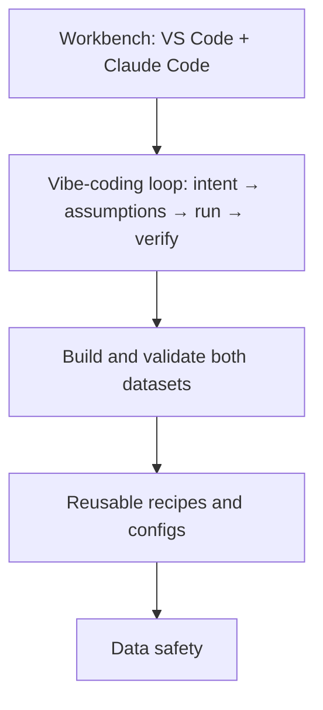

# Day 0 · Build the data and the playbook { .sb-day-title }

**Half a day — can run as pre-work on the Friday before the bootcamp.** By the end you will have a working environment, both
datasets generated and validated on your machine, and the vibe-coding habits the rest of the course relies on.

## Today's mental map

See where today sits in the [big picture](../maps/index.md).

| Lesson | Title | Time (Basic→Adv / Leader) | Outcome |
| --- | --- | --- | --- |
| [L0.1](L0-1.md) | Your workbench: VS Code, Claude Code, Codespaces, Git | 45 / 20 min | Repo open, first conversation with Claude Code |
| [L0.2](L0-2.md) | The vibe-coding playbook for analytics | 60 / 40 min | Prompt anatomy, verification protocol, AI error catalogue |
| [L0.3](L0-3.md) | Build and validate both datasets | 60 / 30 min | {{ a.rt_rows | n }} retail lines and {{ a.fi_rows | n }} bank accounts, validated |
| [L0.4](L0-4.md) | The toolkit: recipes, configs, reuse, Git | 45 / 30 min | First recipe run, reused on the other dataset by config only |
| [L0.5](L0-5.md) | Data safety and anonymisation | 30 / 20 min | Know what never to paste; anonymise before analysis |

Then take the [pre-bootcamp diagnostic](../start/diagnostic.md).

!!! abstract "Day 0 gate"
    Pass all five lesson quizzes (70%) and submit your validation report from L0.3 (row counts, schema check, three issues you
    noticed). Leaders additionally submit a one-paragraph team standard for AI-assisted analysis (L0.2 coaching card).
