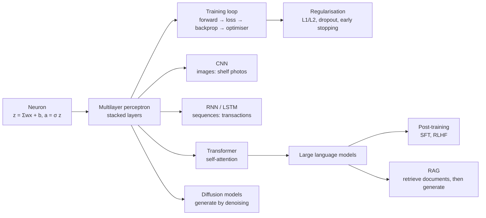
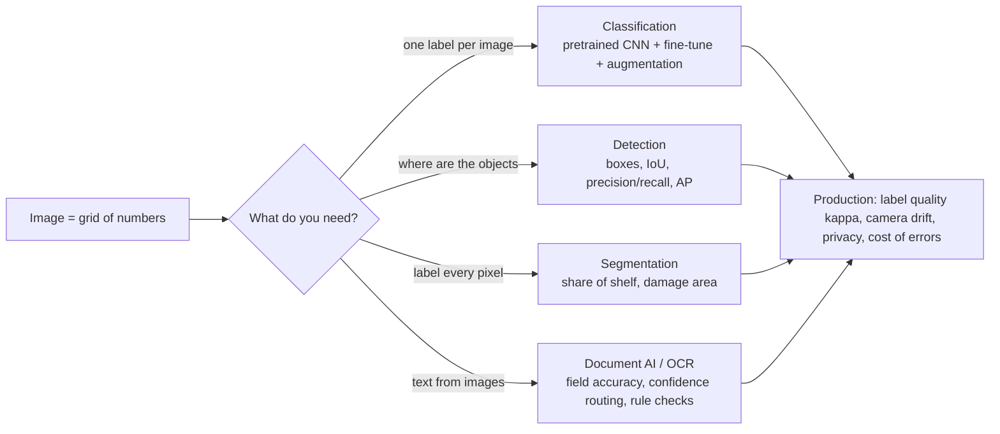

# Mental map · Deep learning and generative AI

## The core formulas (with plain meaning)

| Piece | Formula | Plain meaning | Business intuition |
| --- | --- | --- | --- |
| Neuron | z = Σ wᵢxᵢ + b, a = σ(z) | weigh the inputs, add a bias, squash | a mini-scorecard |
| Activations | ReLU max(0,z); sigmoid 1/(1+e⁻ᶻ); tanh; leaky ReLU | the non-linear switch | lets the network bend |
| Forward pass | z⁽ˡ⁾ = W⁽ˡ⁾a⁽ˡ⁻¹⁾ + b⁽ˡ⁾ | layer after layer of matrix multiplication | linear algebra at scale |
| Loss — regression | MSE = (1/n) Σ (y − ŷ)² | average squared miss | forecast error |
| Loss — classification | cross-entropy = −(1/n) Σ y log ŷ | penalty for confident wrong answers | log-loss of a PD model |
| Backpropagation | ∂L/∂W⁽ˡ⁾ = δ⁽ˡ⁾ a⁽ˡ⁻¹⁾ᵀ (chain rule) | share the blame for the error backwards | which weights to nudge |
| Gradient descent | θ ← θ − η ∇L | step downhill; η = learning rate | too big diverges, too small crawls |
| Adam | momentum + per-parameter step sizes | adaptive steps | default optimiser |
| L2 / L1 | + λ Σ w² / + λ Σ \|w\| | penalise big weights | same as ridge / lasso |
| Dropout | randomly switch off neurons in training | don't rely on any one feature | robustness |
| Early stopping | stop when validation loss rises | quit while ahead | prevents memorising |
| Self-attention | softmax(QKᵀ/√d)V | each token weighs every other token | context matters |
| Diffusion | learn to undo noise added in T steps | generate by denoising random noise | create images / data |

Play with them: [activation functions](../day-09/L9-8.md) · [gradient descent on a 3-D loss surface](../day-09/L9-8.md) ·
[attention heatmap](../day-09/L9-8.md) · [diffusion step by step](../day-09/L9-8.md).

## When to use (and not use) deep learning

| Data | Usually best | Deep learning? |
| --- | --- | --- |
| tabular business data | gradient boosting, GLMs | rarely better; harder to explain |
| images (shelf photos, cheque scans) | CNN / vision transformer | yes |
| text (reviews, complaints, policies) | pretrained transformer + simple classifier; RAG | yes |
| long sequences at scale | transformers, global models | sometimes |
| generating content | transformers (text), diffusion (images) | yes — with governance |

## Computer vision

{{ chart("cv_map", "Vision tasks from simplest to most complex. Hover for retail and banking examples.") }}

Full module: [Day 11 · Computer vision analytics](../day-11/index.md).
