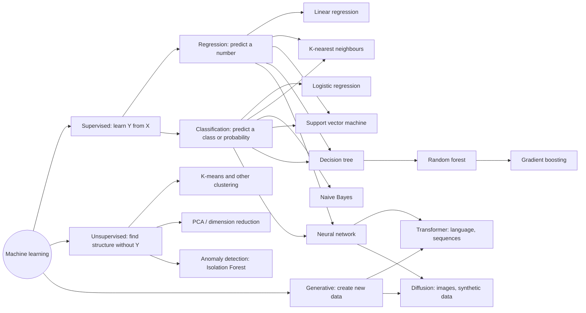

# Mental map · The machine-learning ladder

Machine-learning tools form a **ladder of increasing complexity**. Higher rungs fit more complex patterns but need more data,
more tuning and more effort to explain. **Start at the bottom and climb only when a fair test on held-out data says the next rung
is worth it.**

{{ chart("ml_ladder", "Hover each algorithm for a retail or banking use. Upper-left = simple and explainable; lower-right = powerful and opaque.") }}

## The 13 essential algorithms — where each fits

| Rung | Algorithm | Key idea | Best for | Retail use case | Finance use case | Course lesson |
| --- | --- | --- | --- | --- | --- | --- |
| 1 | **Linear regression** | ŷ = wᵀx + b, minimise squared error | numbers, explainable drivers | weekly Beverages demand from temperature, price, holidays | credit limit as a function of income | L5.1–L5.2 |
| 2 | **Logistic regression** | P(y=1) = 1/(1+e^−(wᵀx+b)) | probabilities, regulated decisions | will a shopper redeem the e-coupon? | probability of default; scorecards | L5.3, L8.7 |
| 3 | **Naive Bayes** | Bayes' rule assuming independent features | fast text classification | route product reviews by topic | triage complaints into categories | L6.3, L6.8 |
| 4 | **K-nearest neighbours** | predict from the k most similar cases | similarity, recommendations | "customers like you also bought" | look-alike applicants | L6.3, L6.8 |
| 5 | **Decision tree** | split data on feature thresholds | transparent rules | which shoppers respond to promotions | simple approval rules | L6.2 |
| 6 | **K-means** | minimise within-cluster squared distance | segmentation | CRM customer segments | behavioural card segments | L8.1 |
| 7 | **PCA** | rotate to directions of maximum variance | compression, collinearity | 12 category-share features → 3 | correlated credit variables | L2.7, L8.1 |
| 8 | **Support vector machine** | widest-margin boundary; kernels bend it | small/medium, high-dimensional data | review sentiment from text | transaction-pattern classification | L6.3, L6.8 |
| 9 | **Random forest** | average many de-correlated trees | robust baseline, interactions | store-level demand drivers | fraud scoring | L6.2 |
| 10 | **Gradient boosting** | trees added sequentially to fix errors | best accuracy on tabular data | demand forecasting with drivers | default and fraud models | L6.2, L7.2 |
| 11 | **Neural network** | layers of weighted sums + non-linear activations | large data, embeddings, images, text | product embeddings for recommendations | large-scale transaction models | L9.3, L9.8 |
| 12 | **Transformer** | self-attention relates every token to every other | language, long sequences | summarise customer reviews; demand from text signals | summarise complaints; RAG over policies | L9.3, L9.8 |
| 13 | **Diffusion model** | learn to reverse step-by-step noising | generating images and data | generate product imagery and shelf mock-ups | synthetic rare-fraud samples for testing | L9.8 |

## Rules for climbing

| Situation | Stay low | Climb |
| --- | --- | --- |
| Need reasons for each decision (credit, pricing) | logistic, scorecard, tree | boosting + explainability, only with sign-off |
| Under ~10k rows, tabular | linear/logistic, small trees | rarely worth it |
| Large tabular data, accuracy matters | — | gradient boosting |
| Images, text, audio | — | neural networks, transformers |
| Generate new content | — | transformers (text), diffusion (images) |

Compare them yourself on real credit data: [model zoo slider](../day-06/L6-8.md). Mathematics underneath: [linear algebra](../day-02/L2-7.md).
